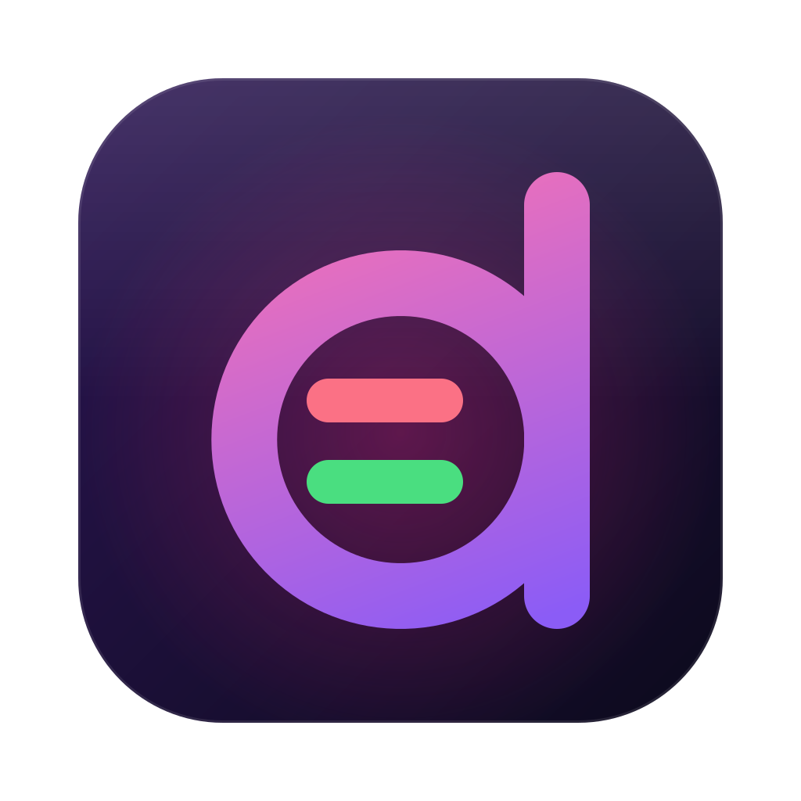
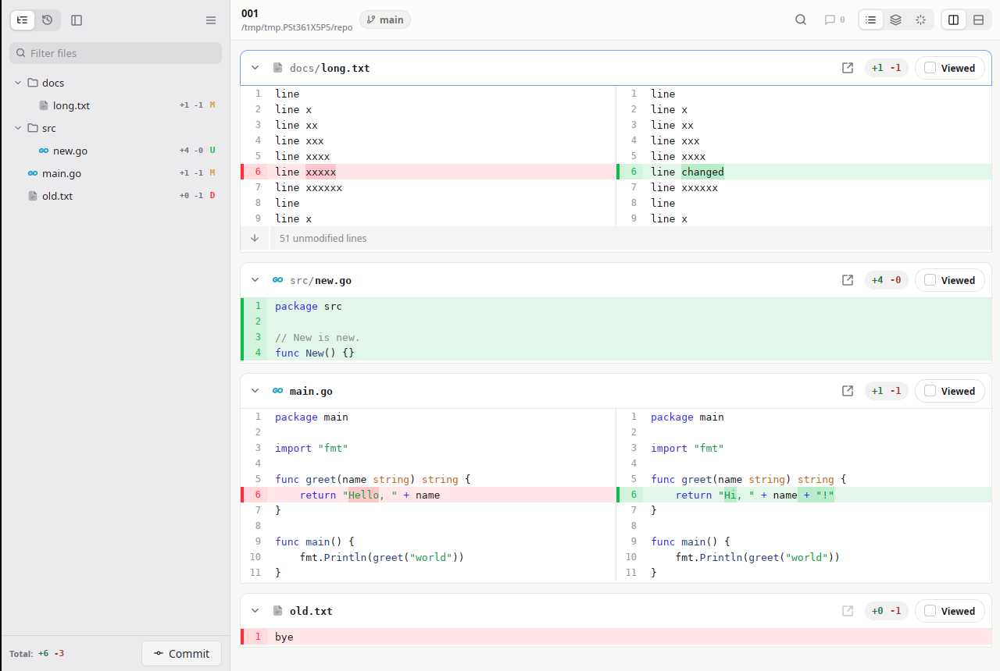

# diffr

A native, minimal, local diff viewer for reviewing Git changes and
committing them, written in Rust and drawn on the GPU
with [GPUI](https://github.com/zed-industries/zed/tree/main/crates/gpui), the UI
framework of the Zed editor. No webview, no JavaScript: Mermaid diagrams are
rendered natively too.



> [!IMPORTANT]
> **The code is available; the project is not run as open source.** I build
> diffr for my own use and publish it as it is. I do not support it, and I
> do not maintain it for uses other than my own: no feature requests, no
> promise to answer issues or to merge pull requests, no roadmap, no
> releases. If you want a feature, fork it — the license lets you.

## Features

- **Review local changes**: staged, unstaged and untracked files against
  `HEAD`, in one scrolling surface of file cards with a pinned header.
- **Split and unified diffs** with syntax highlighting (tree-sitter, as Zed
  does it, in codiff's Licht and Dunkel palettes), word-level change
  highlighting, and unchanged lines that expand 100 at a time or all at once.
  New and deleted files show in one column. Horizontal scrolling per file,
  or word wrap (<kbd>Alt+Z</kbd>).
- **Viewed files**: marking a file viewed collapses it, and it opens again
  once it changes. Generated files and dependency folders start collapsed.
- **Review comments**: click a line, or press <kbd>J</kbd>/<kbd>K</kbd> to
  choose a hunk and <kbd>Enter</kbd>, then copy every comment as Markdown,
  with the diff around it, for an agent or a colleague.
- **Stage while reviewing**: check a file in its header or in the sidebar,
  or press <kbd>S</kbd>; a group of files stages at once from its header.
  Staging is git's index, so the terminal sees the same, and partly staged
  files commit only their staged part.
- **Commit** what is staged (<kbd>Ctrl+Shift+M</kbd>), commit again with
  what is left, and push (or publish a new branch) from the same view.
  **Generate message** (or the ✨ in the subject) has the AI agent write a
  Conventional Commits message for the selected (staged) files.
- **Make commit groups**: from the commit view, the agent splits all the
  changes into focused commits, each with its Conventional Commits message;
  pick one to stage it alone and take its message, then commit.
- **Suggested commits**: a review of uncommitted changes also gives each
  of its groups a Conventional Commits message, so the groups become the
  commits: pick one in the commit view (or **Commit…** on a group) to stage
  it alone and take its message.
- **History**: browse commits and review any of them, or compare the work
  tree with a branch.
- **Pull requests**: list the open pull requests of the repository's GitHub
  remote (<kbd>Ctrl+3</kbd>) and review any of them: diffr fetches its
  commits into your clone; files group by kind; review threads show under
  their lines, to reply to and resolve; comments go out alone or into your
  review, submitted as a comment, an approval or a request for changes. A
  banner says when new commits are pushed.
- **AI review**: a coding agent installed on your machine — Claude Code,
  Codex or OpenCode — reviews the changes, read-only, with its own
  sign-in, and only when you ask. It returns:
  - a summary of the change;
  - the files grouped by intent and listed in reading order (the sidebar
    and the diff follow it);
  - one line atop each file on what changes there and how it fits;
  - sparing "Worth a look" / "Needs care" notes on lines.

  Show notes, summaries, both or none (Settings › AI, the card, the
  View menu); hide the notes with the eye in the toolbar
  (<kbd>Ctrl+Alt+N</kbd>). <kbd>N</kbd> / <kbd>Shift+N</kbd> go from note to
  note. A notification says when a review finishes in the background.
- **Labs** (Settings › Labs): experiments that add instructions, answer
  fields and tools to the review. **Diagrams**: the agent draws Mermaid
  diagrams of what the change does, checks them with `diffr check-diagram`,
  and diffr renders them natively in its colors — added, changed and
  removed parts marked like the diff — in the AI card, each foldable and
  zoomable in a window of its own.
- **Settings window** (<kbd>Ctrl+,</kbd>): General, Review, AI (with the
  full instructions the agent gets), Labs and GitHub.
- **Find in diffs** (<kbd>Ctrl+F</kbd>), a **file filter**
  (<kbd>Ctrl+P</kbd>) and a **command bar** (<kbd>Ctrl+K</kbd>).
- Image previews of changed pictures, a file tree with change counts,
  status letters and file icons, a banner when the work tree changes,
  light and dark themes.

## Getting started

You need Git, a stable Rust toolchain and, on macOS, Xcode with its Metal
Toolchain; on Linux, a Vulkan driver and a few development packages.

```sh
git clone https://github.com/raphaelluethy/diffr.git
cd diffr
cargo run --release -p diffr -- /path/to/a/repository
```

To install it: `scripts/bundle.sh --install` on macOS (see
[Building the macOS app](#building-the-macos-app)), or
`cargo install --locked --path crates/app` anywhere.

Pull requests use the GitHub CLI's login (`gh auth login`); AI review uses
Claude Code, Codex or OpenCode, whichever is installed and signed in.
Neither is needed for the rest.

The **[setup guide](docs/SETUP.md)** has the requirements of each platform,
installing the `diffr` command, GitHub tokens, the agents, and
troubleshooting.

## Usage

```sh
diffr [<commit> | <branch> | <pull request>] [<path>]
```

From a checkout, `cargo run --release -p diffr --` stands for `diffr`.

- `diffr` reviews the uncommitted changes of the repository you are in.
- `diffr HEAD~1` reviews a commit, against its first parent.
- `diffr main` compares the work tree with where it branched off `main`.
- `diffr --pr 123`, `diffr owner/repo#123` or a pull request's URL reviews a
  pull request of the repository's GitHub remote.
- `diffr ../other-repo` opens another repository.

### Keyboard

On macOS read ⌘ for Ctrl.

| Keys | |
|---|---|
| <kbd>Ctrl+K</kbd> | Command bar |
| <kbd>Ctrl+P</kbd> | Filter files |
| <kbd>Ctrl+F</kbd> | Find in diffs |
| <kbd>J</kbd> / <kbd>K</kbd> | Next / previous hunk |
| <kbd>Shift+J</kbd> / <kbd>Shift+K</kbd>, <kbd>]</kbd> / <kbd>[</kbd> | Next / previous file |
| <kbd>}</kbd> / <kbd>{</kbd> | Next / previous group |
| <kbd>g</kbd><kbd>g</kbd> / <kbd>Shift+G</kbd> | Top / end |
| <kbd>Ctrl+D</kbd> / <kbd>Ctrl+U</kbd>, <kbd>Space</kbd> | Half a page / a page |
| <kbd>O</kbd>, <kbd>X</kbd> | Fold the file |
| <kbd>V</kbd> | Mark viewed, then go to the next file |
| <kbd>U</kbd> | Next unviewed file in current results |
| <kbd>Ctrl+Alt+N</kbd> | Show or hide AI notes |
| <kbd>Ctrl+Shift+C</kbd> | Copy the comments as Markdown |
| <kbd>Ctrl+Shift+M</kbd> | Commit |
| <kbd>S</kbd> | Stage or unstage the file |
| <kbd>Ctrl+Shift+Enter</kbd> | Submit the review (pull requests) |
| <kbd>Ctrl+Shift+R</kbd> | Reveal the file in the file manager |
| <kbd>N</kbd> / <kbd>Shift+N</kbd> | Next / previous AI note |
| <kbd>Enter</kbd> | Comment on the hunk chosen |
| <kbd>Ctrl+Enter</kbd> | Add the comment; commit, in the commit view |
| <kbd>Ctrl+Shift+B</kbd> | Toggle the sidebar |
| <kbd>Ctrl+1</kbd> / <kbd>Ctrl+2</kbd> / <kbd>Ctrl+3</kbd> | Files / History / Pull requests |
| <kbd>Ctrl+Shift+I</kbd> | Review with AI |
| <kbd>Alt+Z</kbd> | Toggle word wrap |
| <kbd>Ctrl+Shift+O</kbd> | Open the file in your editor |
| <kbd>Ctrl+O</kbd> | Open a folder |
| <kbd>Ctrl+R</kbd> | Refresh the changes |
| <kbd>Ctrl++</kbd> / <kbd>Ctrl+-</kbd> / <kbd>Ctrl+0</kbd> | Code font size |
| <kbd>?</kbd> | All the shortcuts |

## Configuration

Settings live in `~/.diffr/diffr.jsonc`, with codiff's names,
and apply to open windows as the file changes:

```jsonc
{
  "settings": {
    "codeFontFamily": "",          // empty is DejaVu Sans Mono (Menlo on macOS)
    "codeFontSize": 13,
    "copyCommentsOnClose": false,
    "diffStyle": "split",          // or "unified"
    "editorCommand": "",           // e.g. "zed {file}:{line}"; empty tries Zed, then VS Code
    "githubToken": "",             // empty uses the GitHub CLI's (gh auth login)
    "aiAgent": "",                 // claude, codex or opencode; empty is the first installed
    "aiModel": "",
    "aiFast": false,               // Codex's fast mode, on the models that have it
    "reviewCommentsPrefix": "# Address these Review Comments",
    "sidebarPosition": "left",     // or "right"
    "showWhitespace": false,
    "theme": "system",             // or "light", "dark"
    "wordWrap": false
  }
}
```

## Development

The workspace (`crates/`):

- `git` (`diffr-git`): the repository through the `git` command, parsing
  patches, word-level differences, comments as Markdown, settings and state.
- `highlight` (`diffr-highlight`): tree-sitter highlighting.
- `fileicon` (`diffr-fileicon`): the file icons of @pierre/trees (Apache-2.0).
- `github` (`diffr-github`): the GitHub REST and GraphQL client.
- `agent` (`diffr-agent`): the AI review runtime, running the agents' CLIs;
  its prompts, schema and labs.
- `diagram` (`diffr-diagram`): Mermaid → themed SVG, and its validation.
- `app` (`diffr`): the GPUI application.

```sh
cargo test --workspace
cargo run -p diffr
scripts/licenses.sh                   # target/THIRD_PARTY_LICENSES.html, checking every crate's license
```

## Building the macOS app

```sh
scripts/bundle.sh            # target/release/diffr.app
scripts/bundle.sh --install  # and copies it to /Applications
```

It needs Xcode's Metal Toolchain (`xcodebuild -downloadComponent
MetalToolchain`), `rsvg-convert` (`brew install librsvg`) and `cargo-about`
(`cargo install --locked cargo-about`). The bundle is signed ad hoc, for the
machine that built it.

## Support and contributions

None. diffr is a personal tool whose source is published: it is not
supported, and it changes when I need it to. Issues and pull requests may go
unanswered, and features for other use cases will not be added here. You are
welcome to fork it and take it where you like, under the terms of the
license.

## Thanks

To [godiff](https://github.com/egoist/godiff) by EGOIST, for the
inspiration.

## License

[GPL-3.0-or-later](LICENSE): the GNU General Public License, version 3 or
any later version; the icon is original artwork under the same license. diffr contains Lucide's interface icons (ISC), Pierre's file
icons (Apache-2.0) and other third-party works, listed with their
copyrights in [NOTICE.md](NOTICE.md). The licenses of the crates it links
are collected by `scripts/licenses.sh` into `THIRD_PARTY_LICENSES.html`,
which `scripts/bundle.sh` puts in the app bundle. The logos among the file
icons are trademarks of their owners.
